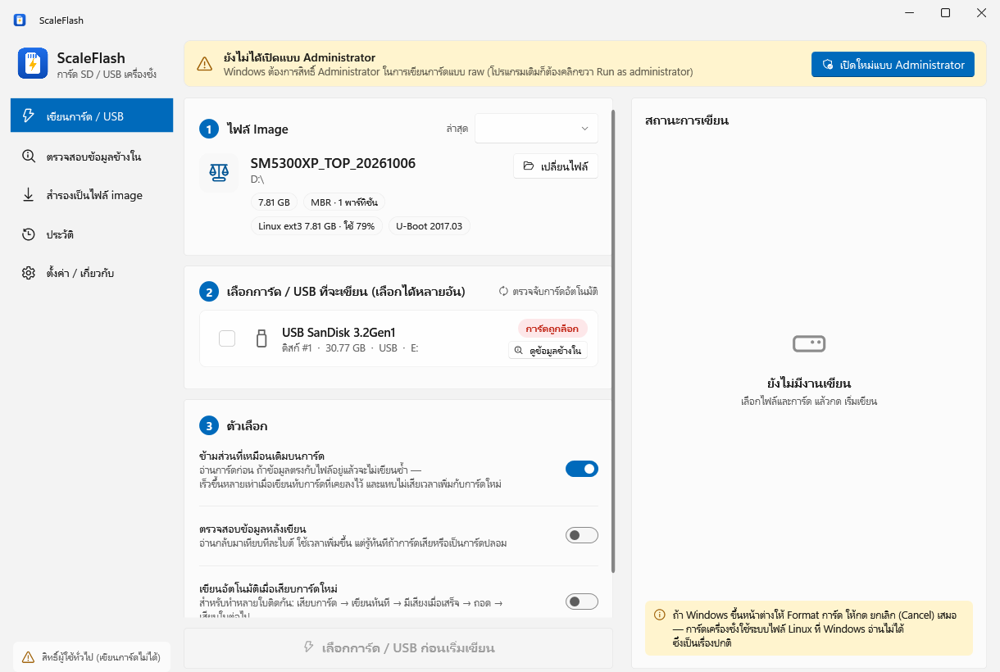
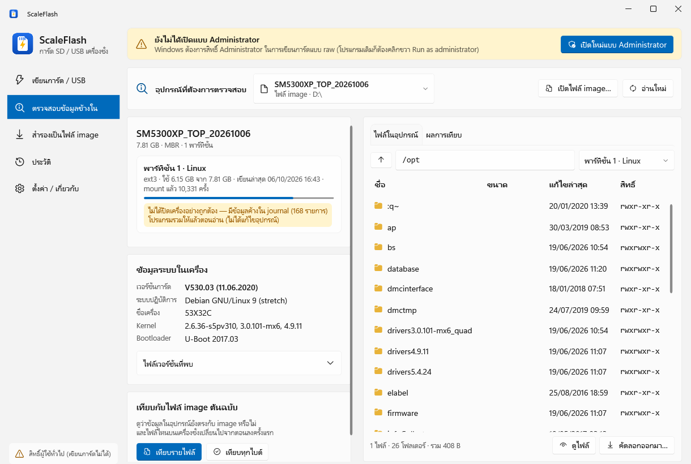
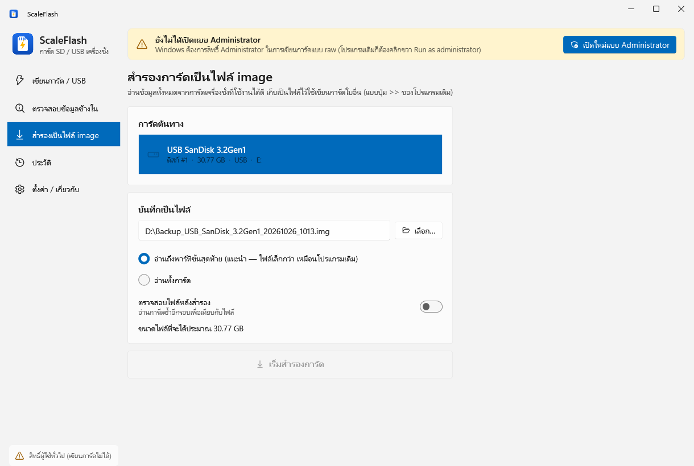
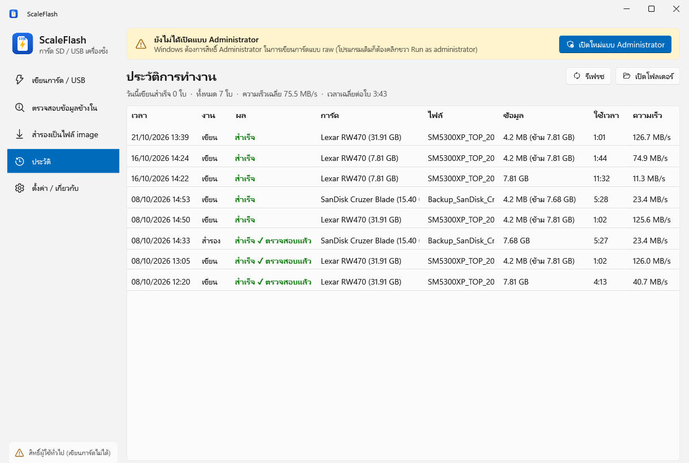
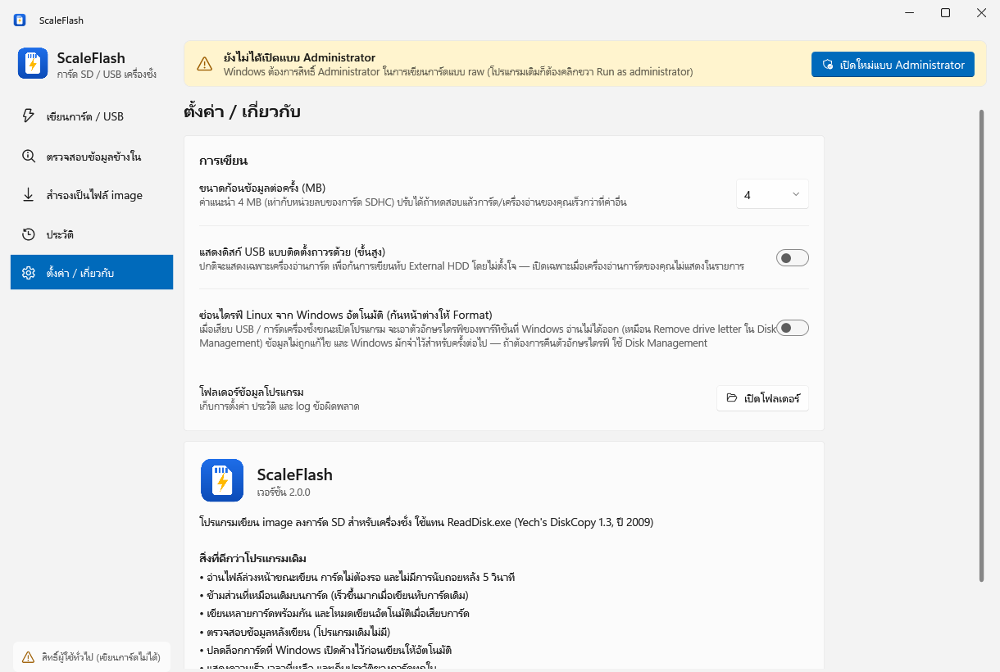

# ScaleFlash

**โปรแกรมเขียน / สำรอง / ตรวจสอบ Image การ์ด SD และแฟลชไดรฟ์ USB ของเครื่องชั่ง** สำหรับ Windows 10/11
ใช้แทน `ReadDisk.exe` (Yech's DiskCopy 1.3, ปี 2009)



---

## สารบัญ

1. [ความสามารถ](#ความสามารถ)
2. [ดาวน์โหลดและติดตั้ง](#ดาวน์โหลดและติดตั้ง)
3. [เขียน Image ลงการ์ด / USB](#1-เขียน-image-ลงการ์ด--usb)
4. [ตรวจสอบข้อมูลข้างใน (ไม่ต้อง Format)](#2-ตรวจสอบข้อมูลข้างใน-ไม่ต้อง-format)
5. [สำรองการ์ด / USB เป็นไฟล์ Image](#3-สำรองการ์ด--usb-เป็นไฟล์-image)
6. [ประวัติ](#4-ประวัติ)
7. [ตั้งค่า](#5-ตั้งค่า)
8. [หน้าต่าง "You need to format the disk"](#หน้าต่าง-you-need-to-format-the-disk)
9. [ข้อความ error และวิธีแก้](#ข้อความ-error-และวิธีแก้)
10. [คำถามที่พบบ่อย](#คำถามที่พบบ่อย)
11. [เทียบกับ ReadDisk.exe](#เทียบกับ-readdiskexe)
12. [Command line](#command-line-สำหรับผู้ดูแลระบบ)
13. [สำหรับนักพัฒนา](#สำหรับนักพัฒนา)

---

## ความสามารถ

| | |
|---|---|
| ✍️ **เขียน image** | ลงการ์ด SD หรือ USB ทีละอันหรือหลายอันพร้อมกัน แสดงความเร็ว (MB/s) และเวลาที่เหลือ |
| ⚡ **ข้ามส่วนที่เหมือนเดิม** | เขียนทับการ์ดที่เคยลง image เดียวกันใช้เวลาประมาณ 1 นาที แทนการเขียนใหม่ทั้งใบ |
| ✅ **ตรวจสอบหลังเขียน** | อ่านกลับมาเทียบกับไฟล์ทีละไบต์ จับการ์ดเสีย / การ์ดปลอมได้ |
| 🔁 **โหมดอัตโนมัติ** | เสียบการ์ด → เขียนทันที → มีเสียงเมื่อเสร็จ เหมาะกับการทำหลายใบติดกัน |
| 🔍 **ตรวจสอบข้อมูลข้างใน** | อ่านระบบไฟล์ Linux (ext2/ext3/ext4) ที่ Windows อ่านไม่ได้: ดูเวอร์ชัน, เปิดดู/คัดลอกไฟล์, เทียบกับ image |
| 💾 **สำรองเป็นไฟล์** | อ่านการ์ด/USB ที่ใช้งานได้ดีเก็บเป็นไฟล์ image ต้นฉบับ |
| 🛡️ **ปลอดภัย** | ไม่แสดงดิสก์ระบบและ External HDD, ยืนยันก่อนเขียน, ตรวจซ้ำว่าการ์ดไม่ถูกสลับ, การ์ดที่เขียนไม่เสร็จจะบูตไม่ขึ้นแทนที่จะทำงานผิดๆ |
| 📋 **ประวัติ** | บันทึกทุกงาน: การ์ดรุ่นไหน ใช้เวลาเท่าไร ความเร็วเท่าไร สำเร็จหรือไม่ |

---

## ดาวน์โหลดและติดตั้ง

1. ไปที่หน้า **[Releases](../../releases)** แล้วดาวน์โหลด `ScaleFlash.exe` ล่าสุด
2. วางไฟล์ไว้ที่ไหนก็ได้ เช่น Desktop **ไม่ต้องติดตั้ง** และไม่ต้องลง .NET เพิ่ม (โปรแกรมรวมทุกอย่างไว้ในไฟล์เดียว ขนาดประมาณ 73 MB)
3. ดับเบิลคลิกเพื่อเปิด แล้วกด **Yes** ที่หน้าต่าง UAC (การเขียนการ์ดแบบ raw ต้องใช้สิทธิ์ Administrator — ไม่ต้องคลิกขวา "Run as administrator" เหมือนโปรแกรมเดิม)

**ความต้องการของระบบ:** Windows 10 หรือ 11 แบบ 64-bit, เครื่องอ่านการ์ด SD หรือพอร์ต USB

> ถ้า Windows SmartScreen ขึ้นว่า "Windows protected your PC" ให้กด **More info → Run anyway** (เพราะไฟล์ยังไม่ได้เซ็นลายเซ็นดิจิทัล)

> **อัปเดตเวอร์ชันใหม่:** ปิดโปรแกรมก่อน แล้วค่อยแทนที่ไฟล์ `ScaleFlash.exe` ด้วยตัวใหม่

---

## 1. เขียน Image ลงการ์ด / USB


### ขั้นตอน

**ขั้นที่ 1 — เลือกไฟล์ Image**
- ลากไฟล์ image มาวางในหน้าต่างโปรแกรม หรือกด **เลือกไฟล์…**
- ไฟล์ไม่จำเป็นต้องมีนามสกุล (เช่น `SM5300XP_TOP_20261006` ใช้ได้เลย) หรือเป็น `.img` `.bin` `.raw` ก็ได้
- โปรแกรมจะแสดงรายละเอียดไฟล์ทันที เช่น `7.81 GB` · `MBR · 1 พาร์ทิชัน` · `Linux ext3 · ใช้ 79%` · `U-Boot 2017.03` ถ้าไฟล์ไม่ใช่ image ของการ์ดจะมีคำเตือน ⚠
- ครั้งต่อไปโปรแกรมจะเปิดไฟล์ล่าสุดให้เอง และเลือกไฟล์ที่เคยใช้ได้จากช่อง **ล่าสุด**

**ขั้นที่ 2 — เลือกการ์ด / USB**
- เสียบการ์ดหรือ USB แล้วรอ 1–2 วินาที รายการจะขึ้นเอง (ไม่ต้องกดรีเฟรช)
- ติ๊ก ☑ อันที่ต้องการเขียน — **เลือกได้หลายอัน จะเขียนพร้อมกัน**
- ป้ายสถานะด้านขวา:

| ป้าย | ความหมาย |
|---|---|
| 🟢 **พร้อม** | เขียนได้ |
| ⚪ **ไม่มีการ์ด** | ช่องเครื่องอ่านการ์ดว่าง |
| 🟠 **เล็กกว่าไฟล์** | ความจุน้อยกว่าไฟล์ image (เขียนได้แต่ข้อมูลท้ายไฟล์จะหาย — ไม่แนะนำ) |
| 🔴 **การ์ดถูกล็อก** | สวิตช์ Lock ข้างการ์ด SD เปิดอยู่ หรืออุปกรณ์ป้องกันการเขียน |
| 🔵 **กำลังทำงาน** | กำลังเขียนอยู่ |

- บรรทัด **"ข้างใน: Linux 7.81 GB"** บอกว่าตอนนี้ในการ์ดมีอะไร ถ้าขึ้นข้อความสีเขียว *"มีระบบเครื่องชั่งอยู่แล้ว"* แปลว่าเขียนทับได้เร็วมากด้วยโหมดข้ามส่วนที่เหมือนเดิม
- ปุ่ม **ดูข้อมูลข้างใน** พาไปหน้าตรวจสอบของการ์ดใบนั้น

**ขั้นที่ 3 — ตัวเลือก**

| ตัวเลือก | ค่าเริ่มต้น | คำอธิบาย |
|---|---|---|
| ข้ามส่วนที่เหมือนเดิมบนการ์ด | เปิด | อ่านการ์ดก่อนเขียนทีละ 4 MB ถ้าตรงกับไฟล์อยู่แล้วจะไม่เขียนซ้ำ ถ้าเป็นการ์ดใหม่ โปรแกรมจะรู้ตัวและหยุดอ่านเปรียบเทียบเอง จึงแทบไม่เสียเวลาเพิ่ม |
| ตรวจสอบข้อมูลหลังเขียน | ปิด | อ่านส่วนที่เขียนกลับมาเทียบทีละไบต์ ใช้เวลาเพิ่ม (การ์ด 32 GB ประมาณ +1 นาที) แต่รู้ทันทีถ้าการ์ดเสีย **แนะนำให้เปิด** กับการ์ดที่ไม่แน่ใจคุณภาพ |
| เขียนอัตโนมัติเมื่อเสียบการ์ดใหม่ | ปิด | ดูหัวข้อ [โหมดอัตโนมัติ](#โหมดเขียนอัตโนมัติ) |

**ขั้นที่ 4 — เริ่มเขียน**
- กด **เริ่มเขียน** → หน้าต่างยืนยันจะแสดงชื่อรุ่นและขนาดของการ์ดทุกใบที่จะถูกลบ → ตรวจให้ถูกแล้วกด **ลบและเขียนเลย**
- แผงขวา **สถานะการเขียน** แสดงแต่ละงาน: เปอร์เซ็นต์ · ความเร็ว MB/s · เวลาที่เหลือ · จำนวนที่ข้ามได้
- เสร็จแล้วจะมีเสียงแจ้ง และขึ้น ✅ **"เสร็จแล้ว — ถอดการ์ดได้เลย"** พร้อมสรุปเวลาและความเร็วเฉลี่ย
- กด **ยกเลิก** ได้ตลอด (การ์ดใบนั้นจะใช้ไม่ได้จนกว่าจะเขียนใหม่ให้เสร็จ — ตั้งใจออกแบบไว้เพื่อไม่ให้เครื่องชั่งบูตระบบที่เขียนไม่ครบ)

> **ถอดการ์ดได้ทันทีเมื่อขึ้น "เสร็จแล้ว"** ไม่ต้องกด Safely Remove

### โหมดเขียนอัตโนมัติ

สำหรับลงการ์ด/USB ทีละหลายใบ:
1. เลือกไฟล์ image ให้เรียบร้อย
2. เปิดสวิตช์ **เขียนอัตโนมัติเมื่อเสียบการ์ดใหม่** → ยืนยัน
3. ถอดการ์ดที่เสียบค้างอยู่ออก (อันที่เสียบอยู่ก่อนเปิดโหมดจะไม่ถูกเขียน)
4. เสียบการ์ดใบแรก → โปรแกรมเริ่มเขียนเองทันที → มีเสียงเมื่อเสร็จ → ถอด → เสียบใบต่อไป
5. ถ้าใช้เครื่องอ่านหลายตัว เสียบพร้อมกันได้เลย

> โหมดนี้จะปิดเองเมื่อเปลี่ยนไฟล์ image เพื่อป้องกันเขียนผิดไฟล์

### ความเร็วที่คาดหวัง

ความเร็วขึ้นกับ **การ์ด/USB และเครื่องอ่าน** เป็นหลัก (ตัวโปรแกรมทำได้ >1 GB/s) ตัวอย่างจากการใช้งานจริง (image 7.81 GB):

| อุปกรณ์ | งาน | เวลา | ความเร็ว |
|---|---|---|---|
| การ์ด Lexar 32 GB + เครื่องอ่าน Lexar RW470 | เขียนการ์ดเปล่าทั้งใบ + ตรวจสอบ | 4:13 | 40.7 MB/s |
| การ์ดเดียวกัน | เขียนทับ (ข้ามส่วนที่เหมือนเดิม) | 1:02 | — |
| การ์ด 8 GB รุ่นเก่า | เขียนทั้งใบ | 11:32 | 11.3 MB/s |
| SanDisk Cruzer Blade 16 GB | สำรองเป็นไฟล์ + ตรวจสอบ | 5:27 | 23.4 MB/s |

**อยากให้เร็วขึ้น:** ใช้การ์ด **U3 / V30 / A1–A2**, เสียบเครื่องอ่านที่พอร์ต **USB 3 (สีฟ้า)**, และเขียนหลายใบพร้อมกันด้วยเครื่องอ่านหลายตัว

---

## 2. ตรวจสอบข้อมูลข้างใน (ไม่ต้อง Format)



ใช้ดูว่าในการ์ด/USB เครื่องชั่งมีอะไร โดย**อ่านอย่างเดียว ไม่แก้ไขข้อมูลบนอุปกรณ์เลย** ใช้กับไฟล์ image ได้ด้วย

### เปิดดู
1. เลือกอุปกรณ์จากช่อง **อุปกรณ์ที่ต้องการตรวจสอบ** หรือกด **เปิดไฟล์ image…** (หรือลากไฟล์มาวางในหน้านี้)
2. รอสักครู่ (ปกติไม่ถึง 1 วินาที)

### ข้อมูลที่แสดง (ซ้าย)

**พาร์ทิชันและสถานะระบบไฟล์** เช่น `ext3 · ใช้ 6.15 GB จาก 7.81 GB · เขียนล่าสุด 06/10/2026 16:43 · mount แล้ว 10,331 ครั้ง`

| สถานะ | ความหมาย |
|---|---|
| 🟢 ปิดเครื่องเรียบร้อย ระบบไฟล์ปกติ | — |
| 🟠 ไม่ได้ปิดเครื่องอย่างถูกต้อง — มีข้อมูลค้างใน journal | เครื่องถูกปิดด้วยการดึงปลั๊ก (พบบ่อยกับเครื่องชั่ง) โปรแกรมรวมข้อมูลค้างให้แล้วตอนอ่าน แบบเดียวกับที่ Linux ทำตอนบูต จึงเห็นข้อมูลล่าสุดถูกต้อง |
| 🔴 ระบบไฟล์เคยมี error | ระบบไฟล์อาจเสียหาย ควรเขียน image ใหม่ |

**ข้อมูลระบบในเครื่อง:** เวอร์ชันการ์ด (เช่น `V530.03 (11.06.2020)` จาก `/opt/.sdVersion`), ระบบปฏิบัติการ (เช่น Debian 9), ชื่อเครื่อง, kernel, bootloader และรายการ **ไฟล์เวอร์ชันที่พบ**

### เปิดดูและคัดลอกไฟล์ (แท็บ "ไฟล์ในอุปกรณ์")
- **ดับเบิลคลิก** โฟลเดอร์เพื่อเข้าไป, ปุ่ม ⬆ เพื่อขึ้น, หรือพิมพ์ path ในช่องด้านบนแล้วกด Enter (เช่น `/opt/pcscale/log`)
- **ดับเบิลคลิกไฟล์** หรือกด **ดูไฟล์** เพื่อเปิดอ่าน (ไฟล์ข้อความแสดงเป็นข้อความ ไฟล์ binary แสดงเป็น hex)
- เลือกไฟล์หรือโฟลเดอร์แล้วกด **คัดลอกออกมา…** → เลือกโฟลเดอร์ปลายทางใน Windows (ถ้าไม่เลือกอะไร จะคัดลอกโฟลเดอร์ที่เปิดอยู่ทั้งโฟลเดอร์) ชื่อไฟล์ที่ Windows ไม่รองรับจะถูกแปลงให้อัตโนมัติ

### เทียบกับไฟล์ image ต้นฉบับ
| ปุ่ม | ใช้เมื่อ | ผลลัพธ์ |
|---|---|---|
| **เทียบรายไฟล์** | อยากรู้ว่าบนเครื่องชั่งมีไฟล์ไหนเปลี่ยนไปจากตอนลงครั้งแรก | รายการไฟล์ **เปลี่ยน / มีเพิ่ม / หายไป** ในแท็บ "ผลการเทียบ" กด **บันทึกรายงาน…** เป็น CSV เปิดใน Excel ได้ |
| **เทียบทุกไบต์** | อยากรู้ว่าการ์ดตรงกับ image 100% หรือไม่ (เช่น หลังเขียนเสร็จ) | ตรงกันทุกไบต์ / ต่างกันกี่ MB ที่ตำแหน่งไหน |

---

## 3. สำรองการ์ด / USB เป็นไฟล์ Image



ใช้เก็บการ์ด/USB ที่ใช้งานได้ดีไว้เป็นไฟล์ต้นฉบับ (เหมือนปุ่ม `>>` ของ ReadDisk)

1. เลือก **การ์ดต้นทาง**
2. ตรวจชื่อไฟล์ (ตั้งให้อัตโนมัติ เช่น `Backup_SanDisk_Cruzer_Blade_20261008_1430.img`) กด **เลือก…** เพื่อเปลี่ยนที่เก็บ
3. เลือก
   - **อ่านถึงพาร์ทิชันสุดท้าย** (แนะนำ) — ได้ไฟล์ขนาดเท่าระบบจริง เช่น 7.68 GB แม้ USB จะ 16 GB
   - **อ่านทั้งการ์ด** — ได้ไฟล์เท่าความจุการ์ด
4. เปิด **ตรวจสอบไฟล์หลังสำรอง** ถ้าจะใช้เป็นต้นฉบับ
5. กด **เริ่มสำรองการ์ด**

โปรแกรมเช็คพื้นที่ว่างให้ก่อนเริ่ม และเขียนลงไฟล์ชั่วคราว `.partial` ก่อน — ถ้าล้มเหลวหรือยกเลิก ไฟล์สำรองเดิมจะไม่ถูกทับ

> **แนะนำ:** หลังสำรอง เปิดไฟล์ที่ได้ในหน้า **ตรวจสอบข้อมูลข้างใน** เพื่อยืนยันว่าเห็นเวอร์ชัน/ไฟล์ครบ

---

## 4. ประวัติ



บันทึกทุกงานเขียนและสำรอง: เวลา, การ์ด, ไฟล์, ผล, จำนวนข้อมูล, เวลาที่ใช้, ความเร็วเฉลี่ย
- คลิกแถวที่ **ไม่สำเร็จ** เพื่อดูสาเหตุ
- ใช้หาการ์ดที่ช้าผิดปกติหรือเสียบ่อย
- ไฟล์ประวัติอยู่ที่ `%LOCALAPPDATA%\ScaleFlash\history.jsonl` (ปุ่ม **เปิดโฟลเดอร์**)

---

## 5. ตั้งค่า



| ตั้งค่า | คำอธิบาย |
|---|---|
| ขนาดก้อนข้อมูลต่อครั้ง (MB) | ค่าเริ่มต้น 4 MB (เท่าหน่วยลบของการ์ด SDHC) ปรับเฉพาะเมื่อทดสอบแล้วอุปกรณ์ของคุณเร็วกว่าที่ค่าอื่น |
| แสดงดิสก์ USB แบบติดตั้งถาวรด้วย (ขั้นสูง) | ปกติซ่อน External HDD/SSD ที่ใหญ่กว่า 128 GB เพื่อกันเขียนทับโดยไม่ตั้งใจ เปิดเฉพาะเมื่ออุปกรณ์ของคุณไม่แสดงในรายการ |
| ซ่อนไดรฟ์ Linux จาก Windows อัตโนมัติ | ดูหัวข้อถัดไป |
| โฟลเดอร์ข้อมูลโปรแกรม | การตั้งค่า, ประวัติ, log ข้อผิดพลาด |

---

## หน้าต่าง "You need to format the disk"

Windows ขึ้นหน้าต่างนี้เพราะให้ตัวอักษรไดรฟ์ (เช่น `E:`) กับพาร์ทิชัน Linux ที่ตัวเองอ่านไม่ได้ — **การ์ด/USB ไม่ได้เสีย ห้ามกด Format** ให้กด **Cancel** เสมอ

วิธีลดหน้าต่างนี้:
- หน้า **ตรวจสอบข้อมูลข้างใน** → กดปุ่ม **ซ่อนจาก Windows (กันหน้าต่าง Format)** หรือ
- **ตั้งค่า → ซ่อนไดรฟ์ Linux จาก Windows อัตโนมัติ**

ทั้งสองแบบทำเหมือนเมนู "Remove drive letter" ใน Disk Management — **ข้อมูลบนอุปกรณ์ไม่ถูกแก้ไข** ถ้าต้องการคืนตัวอักษรไดรฟ์ ใช้ Disk Management (`diskmgmt.msc`)

---

## ข้อความ error และวิธีแก้

| ข้อความ | วิธีแก้ |
|---|---|
| การ์ดถูกล็อกป้องกันการเขียน | เลื่อนสวิตช์ Lock ข้างการ์ด SD ขึ้น แล้วเสียบใหม่ |
| Windows ไม่อนุญาตให้เขียน / ไม่มีสิทธิ์ | ปิดหน้าต่าง Explorer ที่เปิดการ์ดอยู่ และเปิดโปรแกรมแบบ Administrator |
| มีโปรแกรมอื่นใช้งานการ์ดอยู่ | ปิดโปรแกรมนั้น (เช่น ReadDisk) แล้วลองใหม่ |
| ไม่พบการ์ด / การ์ดถูกถอดออก | เสียบการ์ดให้แน่น หรือเปลี่ยนช่อง/พอร์ต |
| เครื่องอ่านการ์ดไม่ตอบสนอง | ถอดเสียบเครื่องอ่านใหม่ หรือเปลี่ยนพอร์ต USB |
| เขียนลงการ์ดไม่สำเร็จ: การ์ดอาจเสีย | เปลี่ยนการ์ดใบใหม่ |
| ตรวจสอบไม่ผ่าน | การ์ดเสียหรือเป็นการ์ดปลอม — เปลี่ยนการ์ด |
| การ์ดเล็กเกินไป | ใช้การ์ดที่ความจุมากกว่าไฟล์ image (การ์ด "8 GB" บางยี่ห้อเล็กกว่า 7.81 GB → ใช้ 16 GB ขึ้นไป) |
| การ์ดในเครื่องอ่านเปลี่ยนไปจากที่เลือกไว้ | มีการสลับการ์ดหลังเลือก — เลือกการ์ดใหม่อีกครั้ง |

Log ข้อผิดพลาดอยู่ที่ `%LOCALAPPDATA%\ScaleFlash\error.log`

---

## คำถามที่พบบ่อย

**ทำไมการ์ด/USB ไม่ขึ้นในรายการ?**
ตรวจว่าเสียบแน่นและไฟเครื่องอ่านติด ถ้าเป็นแฟลชไดรฟ์ที่ใหญ่กว่า 128 GB หรือเป็นดิสก์ USB แบบติดตั้งถาวร ให้เปิด **ตั้งค่า → แสดงดิสก์ USB แบบติดตั้งถาวรด้วย** (ระวังเลือกให้ถูกตัว)

**เขียนไม่เสร็จ / ถอดการ์ดกลางคัน การ์ดเสียไหม?**
ไม่เสีย แค่เขียนใหม่ให้เสร็จ การ์ดที่เขียนไม่เสร็จจะบูตไม่ขึ้นโดยตั้งใจ เพื่อไม่ให้เครื่องชั่งทำงานด้วยระบบที่ไม่ครบ

**ทำไมการ์ด 8 GB ยังช้า?**
การ์ดรุ่นเก่าเขียนได้แค่ 4–13 MB/s ซึ่งเป็นขีดจำกัดของการ์ดเอง ถ้าเคยลง image เดียวกันไว้แล้ว โหมดข้ามส่วนที่เหมือนเดิมจะช่วยมาก ถ้าเป็นการ์ดใหม่ ควรเปลี่ยนเป็นการ์ดที่เร็วกว่า

**เปิดโปรแกรมแล้วขึ้น "ScaleFlash เปิดอยู่แล้ว"?**
ดูที่แถบงานด้านล่าง โปรแกรมเปิดได้ทีละหน้าต่าง (กันเขียนการ์ดใบเดียวกันซ้อนกัน) ถ้ามีตัวเก่าค้างโดยไม่มีหน้าต่าง โปรแกรมจะปิดตัวที่ค้างให้เอง

**ใช้กับ Windows 7 หรือ 32-bit ได้ไหม?**
ไม่ได้ ต้องเป็น Windows 10/11 64-bit

---

## เทียบกับ ReadDisk.exe

| | ReadDisk.exe | ScaleFlash |
|---|---|---|
| วิธีอ่าน/เขียน | อ่าน 2 MB แล้วเขียน 2 MB สลับกัน | อ่านล่วงหน้าขณะเขียน ก้อนละ 4 MB การ์ดไม่ต้องรอ |
| ก่อนเริ่ม | นับถอยหลัง 5 วินาที | หน้าต่างยืนยันพร้อมชื่อรุ่นและขนาดการ์ด |
| เขียนทับการ์ดเดิม | เขียนใหม่ทั้งหมดทุกครั้ง | ข้ามส่วนที่เหมือนเดิม |
| หลายการ์ด | ทีละใบ | พร้อมกัน + โหมดอัตโนมัติ |
| ตรวจสอบหลังเขียน | ไม่มี | มี |
| ดูข้อมูล Linux ข้างใน | ไม่มี | มี (เวอร์ชัน, ไฟล์, เทียบ image) |
| การ์ดที่ Windows เปิดค้าง | อาจ error 5 | lock/dismount ให้อัตโนมัติ |
| ความปลอดภัย | แสดงดิสก์ removable ทุกตัว | ซ่อนดิสก์ระบบ/External HDD, ตรวจซ้ำก่อนเขียน |
| ข้อมูลระหว่างทำงาน | % อย่างเดียว | MB/s, เวลาที่เหลือ, ประวัติ, error ภาษาไทย |
| ลองใหม่เมื่อเขียนพลาด | 10 ครั้ง | 3 ครั้ง (หยุดทันทีถ้าลองใหม่ไม่ช่วย เช่นการ์ดล็อก) |
| คัดลอกการ์ด → การ์ดโดยตรง | มี | ยังไม่มี (สำรองเป็นไฟล์ก่อนแล้วเขียน) |
| แก้ไข sector แบบ hex | มี | ยังไม่มี (ดูได้ระดับไฟล์) |
| ขนาด / Windows | 68 KB / XP ขึ้นไป | 73 MB / Windows 10–11 64-bit |

---

## Command line (สำหรับผู้ดูแลระบบ)

`scaleflash.exe` (ไฟล์แยกในหน้า Releases) ต้องเปิด Terminal แบบ Administrator

```
scaleflash list                                   แสดงการ์ด/USB ทั้งหมด
scaleflash info D:\SM5300XP_TOP_20261006          ดูโครงสร้างไฟล์ image
scaleflash write D:\SM5300XP_TOP_20261006 --disk 2 --verify
scaleflash backup --disk 2 D:\backup.img [--whole] [--verify]
scaleflash bench --disk 2                         วัดความเร็วเขียน (ลบข้อมูลบนการ์ด!)

scaleflash inspect disk:2                         ดูเวอร์ชัน/ระบบไฟล์ (อ่านอย่างเดียว)
scaleflash ls disk:2 /opt                         ดูรายการไฟล์
scaleflash cat disk:2 /opt/.sdVersion             แสดงเนื้อหาไฟล์
scaleflash diff disk:2 D:\SM5300XP_TOP_20261006   ไฟล์ไหนต่างจาก image
scaleflash rawdiff disk:2 D:\SM5300XP_TOP_20261006   เทียบทุกไบต์
scaleflash hide-letters --disk 2                  ซ่อนไดรฟ์ Linux จาก Windows
```

ใช้ path ของไฟล์ image แทน `disk:N` ได้ทุกคำสั่งอ่าน เช่น `scaleflash inspect D:\SM5300XP_TOP_20261006`

---

## สำหรับนักพัฒนา

### โครงสร้าง
```
src/ScaleFlash.Core   engine เขียน/อ่าน/ตรวจสอบ, ตรวจหาอุปกรณ์, ตารางพาร์ทิชัน (MBR/GPT),
                      ตัวอ่าน ext2/3/4 พร้อมกู้ journal (jbd2) ในหน่วยความจำ, ตัวเทียบไฟล์
src/ScaleFlash.App    หน้าจอ WPF (.NET 10 + WPF-UI, Fluent, ภาษาไทย)
src/ScaleFlash.Cli    command line
tests/                unit tests + ไฟล์ทดสอบ ext2/3/4 ที่สร้างจาก Linux (Fixtures/make-fixtures.sh)
```

### Build
ต้องมี [.NET 10 SDK](https://dotnet.microsoft.com/download)
```
dotnet test
dotnet publish src/ScaleFlash.App -c Release -r win-x64 --self-contained -p:PublishSingleFile=true -p:IncludeNativeLibrariesForSelfExtract=true -p:EnableCompressionInSingleFile=true -p:PublishReadyToRun=true -o publish
dotnet publish src/ScaleFlash.Cli -c Release -r win-x64 --self-contained -p:PublishSingleFile=true -p:EnableCompressionInSingleFile=true -o publish/cli
```

### การทดสอบ
- 37 unit tests: การ์ดเสีย, การ์ดล็อก, error ชั่วคราว, ยกเลิกกลางคัน, ข้ามส่วนที่เหมือน, ตรวจสอบ, ตารางพาร์ทิชัน, ext2/ext3/ext4 (indirect, extents, htree, sparse, symlink, ชื่อไทย) รวมถึงระบบไฟล์ที่ถูกดึงปลั๊กขณะ mount (ต้องกู้ journal)
- ตัวอ่าน ext ทดสอบกับ image เครื่องชั่งจริง: ผลตรงกับ Linux kernel ทุกไฟล์ (131,410 รายการ เทียบ SHA-256)
- ทดสอบกับฮาร์ดแวร์จริง: เขียน/ตรวจสอบการ์ด SD ผ่าน Lexar RW470 และสำรอง/อ่าน USB SanDisk
